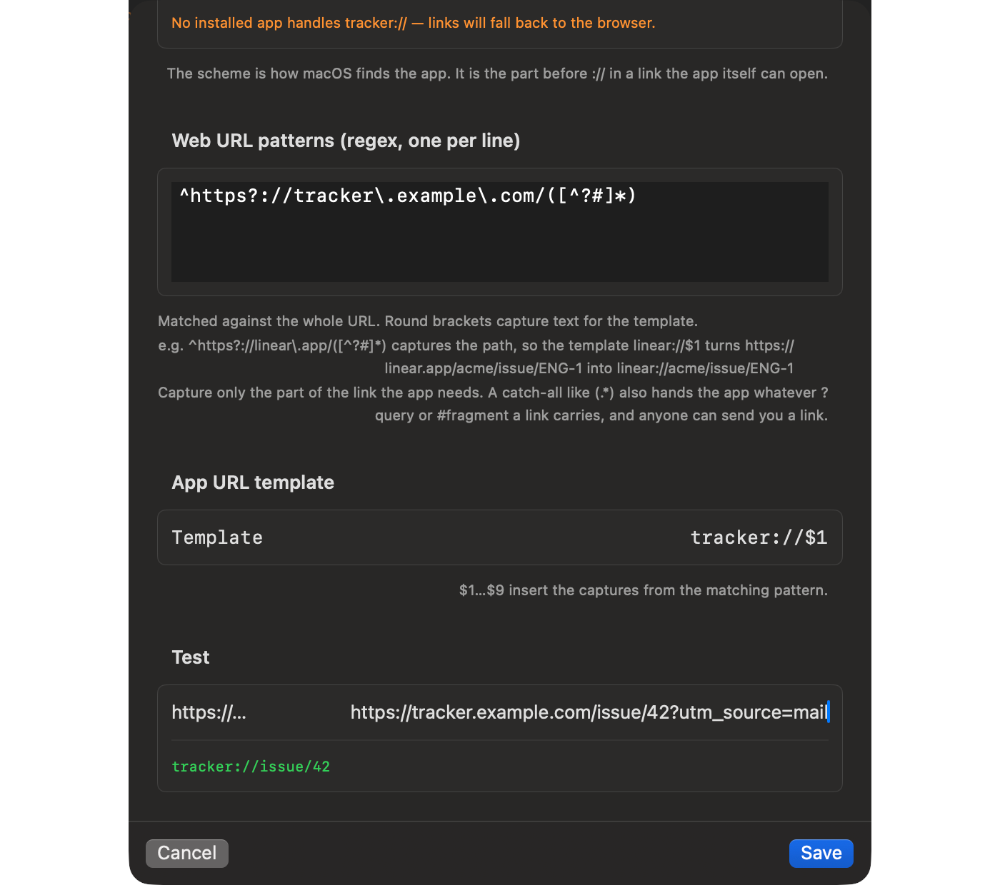

# Open a website's links in its Mac app, even if Junction doesn't know it yet

Junction is a free, open-source macOS app that becomes your default browser and routes each link by your rules. It ships deep links for apps like Zoom, Slack, and Figma, and you can add your own: tell Junction how a site's web links map to its app's links, and they open in the app.

## How do I open a website's links in its Mac app?

First check whether Junction already knows the app: **Settings → Deep Links** lists every built-in deep link, off until you turn it on. If the app isn't there, click **Deep Links → Add App…** and give it four things:

| Field | What it is | Example |
| --- | --- | --- |
| Name | What the app is called | `Tracker` |
| URL scheme | The scheme the app registers | `tracker` |
| Pattern | A regex for the web link, with capture groups | `^https?://tracker\.example\.com/([^?#]*)` |
| Template | The app link, with `$1`, `$2` for the captures | `tracker://$1` |

The dialog has a test field: paste a real link and check the app link it produces before you save.



## How do I find an app's URL scheme?

Read it from the app's `Info.plist`. The schemes are listed under `CFBundleURLSchemes`:

```text Terminal
$ defaults read /Applications/Slack.app/Contents/Info.plist CFBundleURLTypes
(
        {
        CFBundleURLName = Slack;
        CFBundleURLSchemes =         (
            slack
        );
    }
)
```

A deep link only fires when an app that handles its scheme is installed. Without one, the link opens in your fallback browser.

## How do I write the pattern and template?

Capture only the part of the link the app needs. `[^?#]*` stops at the query and fragment; a catch-all `(.*)` would hand the link's tracking query straight to the app.

| Web link | Pattern capture `$1` | Template `tracker://$1` gives |
| --- | --- | --- |
| `https://tracker.example.com/issue/42` | `issue/42` | `tracker://issue/42` |
| `https://tracker.example.com/issue/42?utm_source=mail` | `issue/42` | `tracker://issue/42` |

What the app expects after the scheme is up to the app — check its documentation for the link format it accepts.

## Where does my app end up in the config?

In `customRewriters`. It behaves exactly like a built-in deep link, including as a `deepLink` rule action — use its `id` there.

```json config
{
  "customRewriters": [{ "id": "tracker", "name": "Tracker", "patterns": ["^https?://tracker\\.example\\.com/([^?#]*)"], "template": "tracker://$1", "scheme": "tracker" }],
  "rules": [{ "name": "Tracker → app", "match": { "patterns": ["tracker.example.com/*"] }, "action": { "deepLink": "tracker" } }]
}
```

Naming yours after a built-in replaces that built-in.

## What if the link doesn't match my pattern?

It opens in your fallback browser. Junction never drops a link or opens the wrong screen: an app that isn't installed, a pattern that doesn't match, or an unknown deep link all degrade to the fallback. If a rule keeps landing there, see [why links open in the wrong browser](links-open-wrong-browser.md).

## Can I add my app for everyone?

Yes. Built-in deep links are data, not code — a JSON file in Junction's repository — so adding an app for everyone is a JSON-only pull request. [CONTRIBUTING.md](https://github.com/jnahian/junction/blob/main/CONTRIBUTING.md) has the steps.

To see what's already built in, start with [Zoom and Teams](zoom-teams-links.md) and [Figma, Notion and Linear](figma-notion-linear-links.md).

## Get Junction

Junction is free and MIT-licensed, for macOS 13 or later on Apple silicon and Intel. [Install it](/#install) with Homebrew or the DMG, then follow the [first-launch steps](/docs#quickstart).
