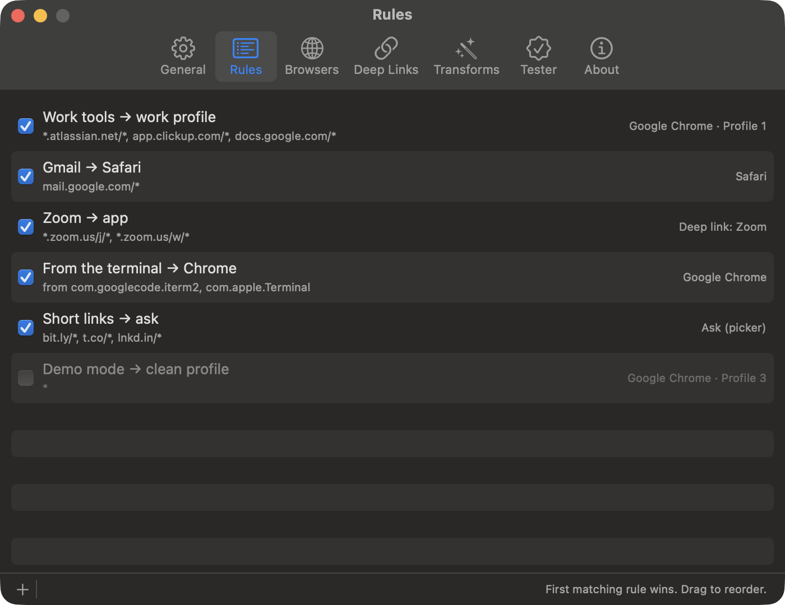

# Use a different browser for different websites on your Mac

Junction is a free, open-source macOS app that becomes your default browser and routes each link by your rules. macOS lets you pick only one default browser; with Junction in that slot, every website can have its own — and any site without a rule goes to the browser you pick as the fallback.



## Can I set a different default browser for some websites?

Yes. Make Junction your default browser, then add a rule for each site that should open somewhere else. Every link you click passes through Junction, which opens it in the browser its rule names.

```json rule
{
  "name": "Google Docs → Chrome",
  "match": { "patterns": ["docs.google.com/*", "drive.google.com/*"] },
  "action": { "app": "com.google.Chrome" }
}
```

```text junction test
$ junction test "https://docs.google.com/document/d/1abc/edit"
input:       https://docs.google.com/document/d/1abc/edit
rule:        [1] Google Docs → Chrome
action:      open in com.google.Chrome
url:         https://docs.google.com/document/d/1abc/edit
```

Rules name a browser by its bundle ID:

| Browser | Bundle ID |
| --- | --- |
| Safari | `com.apple.Safari` |
| Google Chrome | `com.google.Chrome` |
| Firefox | `org.mozilla.firefox` |
| Microsoft Edge | `com.microsoft.edgemac` |
| Brave | `com.brave.Browser` |

A rule can also pick a browser *profile* — see [Chrome profiles](chrome-profile-links.md) and [Firefox profiles](firefox-profile-links.md). To split work from personal browsing this way, see [keeping work and personal separate](work-personal-browsing.md).

## How do I make Junction my default browser?

Choose it under **System Settings → Desktop & Dock → Default web browser**. Junction only sees links while it's the default — that's the one step it can't work without.

Junction's first launch walks you through it, along with picking a fallback browser and a few starter rules.

## What happens to websites without a rule?

They open in your **fallback** browser. So does any link whose rule can't be carried out — a browser that isn't installed, or a profile that was deleted. Junction never drops a click.

```json config
{
  "fallback": { "app": "com.apple.Safari" }
}
```

Set the fallback to `"picker"` instead and every unmatched link asks you where to open — see [choosing a browser per link](choose-browser-per-link.md).

## Which rule wins when two rules match?

The higher one. Junction checks rules from the top and stops at the **first** match, so put specific rules above broad ones.

| Rules, top to bottom | A `mail.google.com` link opens in |
| --- | --- |
| `mail.google.com/*` → Safari, then `*.google.com/*` → Chrome | Safari |
| `*.google.com/*` → Chrome, then `mail.google.com/*` → Safari | Chrome — the Safari rule never runs |

If a link lands in the wrong browser, a broader rule above is almost always the reason — [here's how to find it](links-open-wrong-browser.md).

## How do website patterns match?

Patterns match the link's host and path. The scheme is ignored, the host is case-insensitive, the path is case-sensitive, and the query string is ignored.

| Pattern | Matches |
| --- | --- |
| `reddit.com` | That host, every path on it |
| `app.clickup.com/*` | That exact host, any path below it |
| `*.atlassian.net/*` | Every subdomain *and* `atlassian.net` itself |
| `*.zoom.us/j/*` | `*` stays inside one path segment; `**` or a trailing `*` crosses segments |

When the query string matters, use `regex`, which matches the full URL.

## Can a website open in its Mac app instead of a browser?

Yes, for apps with a deep link: Zoom, Slack, Figma, Spotify, and more. See [Zoom and Teams links](zoom-teams-links.md), or [add an app yourself](custom-app-deep-links.md).

## Get Junction

Junction is free and MIT-licensed, for macOS 13 or later on Apple silicon and Intel. [Install it](/#install) with Homebrew or the DMG, then follow the [first-launch steps](/docs#quickstart).
