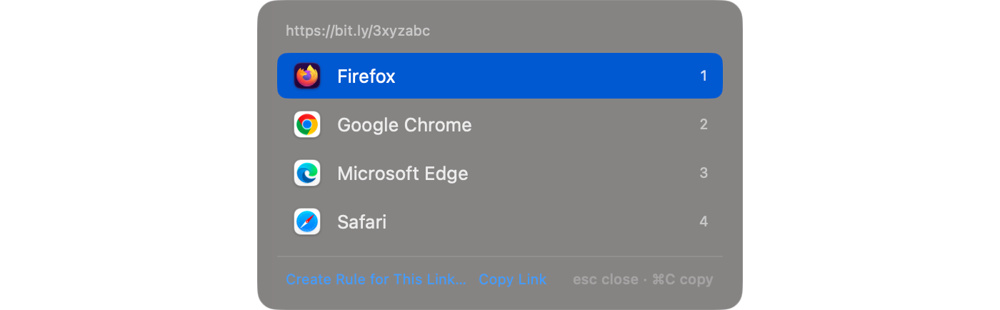

# Open several links at once in the browser you choose

Junction is a free, open-source macOS app that becomes your default browser and routes each link by your rules. When links go to its picker, they don't each get their own prompt: every link that arrives while the picker is open joins one list, and one choice opens them all.



## How do I open several links in the same browser at once?

Send them to the picker, then choose a browser once. Links sent to the picker while it's open collect in one list, and choosing a browser opens every link in it there.

Links reach the picker in three ways:

| How | When |
| --- | --- |
| Hold **⌥ Option** while clicking | Any link, whatever your rules say |
| A rule with the `prompt` action | Every link that rule matches |
| `"fallback": { "app": "picker" }` | Every link no rule matches |

## Can I copy all the links instead of opening them?

Yes. Click **Copy 3 Links** (the count matches your list) or press **⌘C** in the picker, and every link goes to the clipboard, one per line — ready to paste into a note, a message, or a document.

## How do I cancel the whole list?

Press **Esc**, or click away from the picker. That cancels every link in the list, not just the last one.

## Can links from one app always go to the picker?

Yes. Combine `sourceApps` with the `prompt` action, and every link clicked in that app asks first. Here, links from Messages:

```json rule
{
  "name": "From Messages → ask",
  "match": { "sourceApps": ["com.apple.MobileSMS"] },
  "action": { "prompt": true }
}
```

```text junction test
$ junction test "https://example.com/shared-article" --source com.apple.MobileSMS
input:       https://example.com/shared-article
source:      com.apple.MobileSMS
rule:        [1] From Messages → ask
action:      show picker
url:         https://example.com/shared-article
```

Put it near the top of your list, so no site rule catches those links first. More app-based rules are in [routing links by app](links-from-apps.md).

## Can the picker show browser profiles too?

Yes — profiles appear alongside browsers, and **Settings → Browsers** chooses which ones show. The layout, labels, and icon size are covered in [choosing a browser per link](choose-browser-per-link.md#how-do-i-change-how-the-picker-looks).

## Get Junction

Junction is free and MIT-licensed, for macOS 13 or later on Apple silicon and Intel. [Install it](/#install) with Homebrew or the DMG, then follow the [first-launch steps](/docs#quickstart).
