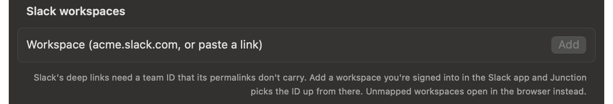

# Open Slack, Discord, and Telegram links in their apps

Junction is a free, open-source macOS app that becomes your default browser and routes each link by your rules. Its deep links send a Slack permalink straight to the message in the Slack app, and do the same for Discord channels and Telegram chats.

## How do I open Slack links in the Slack app?

Add your workspace in **Settings → Deep Links**, then turn on the Slack deep links there or use a rule. A message link then opens on that message in the app.

```json rule
{
  "name": "Slack → app",
  "match": { "patterns": ["*.slack.com/archives/*/*"] },
  "action": { "deepLink": "slack" }
}
```

Junction has two Slack deep links: `slack` for message links and `slack-channel` for channel links.

## Why does Slack need my workspace first?

Slack's app links need a team ID, and Slack permalinks don't carry one. Junction maps each workspace's subdomain to its team ID:

- **In Settings:** type the workspace name or paste a Slack link, and Junction reads the ID from the signed-in Slack app.
- **In the config file:** map subdomain to team ID yourself in `slackTeams`.

```json config
{
  "slackTeams": { "acme": "T01ABCDEF" }
}
```



A link from a workspace that isn't mapped opens in the browser, rather than on the wrong screen in the app.

## How do I open Discord links in the Discord app?

Turn on **Discord** in **Settings → Deep Links**, or add a rule for channel links.

```json rule
{
  "name": "Discord → app",
  "match": { "patterns": ["*.discord.com/channels/*"] },
  "action": { "deepLink": "discord" }
}
```

```text junction test
$ junction test "https://discord.com/channels/123456789/987654321"
input:       https://discord.com/channels/123456789/987654321
rule:        [1] Discord → app
action:      deep link (discord)
url:         discord://-/channels/123456789/987654321
```

## How do I open t.me links in Telegram?

Turn on **Telegram** in **Settings → Deep Links**, or add a rule for `t.me` links. Usernames and channel posts both open in the app.

```json rule
{
  "name": "Telegram → app",
  "match": { "patterns": ["t.me/*"] },
  "action": { "deepLink": "telegram" }
}
```

```text junction test
$ junction test "https://t.me/durov"
input:       https://t.me/durov
rule:        [1] Telegram → app
action:      deep link (telegram)
url:         tg://resolve?domain=durov
```

WhatsApp `wa.me` links have a built-in deep link too.

## Can links clicked *in* Slack go to a work browser?

Yes — that's a different rule, which matches the app the click came from. See [routing links by app](links-from-apps.md). Meeting links are in [Zoom and Teams links](zoom-teams-links.md).

## Get Junction

Junction is free and MIT-licensed, for macOS 13 or later on Apple silicon and Intel. [Install it](/#install) with Homebrew or the DMG, then follow the [first-launch steps](/docs#quickstart).
