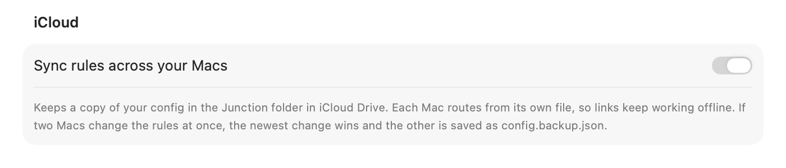

# Sync your link rules across Macs with one config file

Junction is a free, open-source macOS app that becomes your default browser and routes each link by your rules. Those rules live in one plain-text JSON file you own, so you can version it, sync it to your other Macs with iCloud, or share it with your team.

## Where is Junction's config file?

At `~/.config/junction/config.json`. If you set `$XDG_CONFIG_HOME`, Junction uses that directory instead of `~/.config`. To print the path Junction is actually using:

```text Terminal
$ junction config path
```

## Can Junction sync my rules with iCloud?

Yes. Turn on **Sync rules across your Macs** under **Settings → General** on each Mac. Junction keeps a copy of your config in the Junction folder in iCloud Drive, under your own Apple account. There's no Junction account and no Junction server.



Each Mac still routes from its own `config.json`, so links keep working offline and `junction test` reads the same file as always. iCloud Drive has to be on, and macOS may ask once for permission to access it.

| When you turn it on | What happens |
| --- | --- |
| iCloud Drive has no rules yet | Junction confirms, then uploads this Mac's rules |
| iCloud Drive has the same rules | Sync starts without asking |
| iCloud Drive has different rules | You pick **Use iCloud's Rules** or **Replace with This Mac's Rules** |
| The iCloud copy has errors | You can only replace it with this Mac's rules |

The rules you don't keep are saved as `config.backup.json` next to your config file.

On your second Mac, let iCloud Drive finish downloading the copy before you turn sync on. If it hasn't arrived, Junction sees no rules in iCloud and offers to upload this Mac's, which would replace the ones you synced. Cancel and try again once the Junction folder in iCloud Drive has your config.

## What happens when two Macs change the rules?

The newest change wins, and the rules it replaced are saved as `config.backup.json` next to your config file. That file holds one set of rules, so the next replacement overwrites it.

| Situation | What Junction does |
| --- | --- |
| One Mac changes the rules | The other Macs pick up the change and reload |
| Two Macs change them before syncing | The newest change wins, and the other goes to the backup |
| The iCloud copy has an error | This Mac keeps its rules, and Settings shows the problem |
| You save an invalid edit on this Mac | It stays on this Mac and isn't uploaded |
| The iCloud copy gets deleted | Junction doesn't recreate it. Turn sync off and on to upload again |

Turning sync off stops this Mac from syncing and leaves the iCloud copy in place for your other Macs.

## Can I keep my Junction rules in git?

Yes. The config file is plain JSON, so commit it to your dotfiles like any other config. Settings writes strict JSON with **sorted keys**, so a change made in the app shows up as a small, clean diff.

```json config
{
  "version": 1,
  "fallback": { "app": "com.apple.Safari" },
  "stripTrackingParams": true,
  "rules": [{ "name": "Work tools → work profile", "match": { "patterns": ["*.atlassian.net/*", "docs.google.com/*"] }, "action": { "app": "com.google.Chrome", "profile": "Profile 1" } }]
}
```

## Can the config file have comments?

Yes, when you edit it by hand: Junction accepts comments and trailing commas when it reads the file. Settings saves strict JSON, though, so keep the comments only if you make your changes in the file rather than in the app.

## What happens when the config file changes?

Junction watches the file and reloads it as soon as it changes — a `git pull` takes effect without restarting anything.

- **A valid edit** goes live immediately.
- **An invalid edit** doesn't break routing: Junction keeps the last rules that worked and shows a warning in the menu bar until you fix the file.

## How do I check a config before committing it?

Run `junction config validate`. It runs the same validation the app and the file watcher use, so a config that passes is a config Junction will load. To see which rule a link hits, run `junction test` with the link — see [why links open in the wrong browser](links-open-wrong-browser.md).

## Can a team share one rules file?

Yes, with one caveat: rules name browsers by bundle ID, which is the same on every Mac, but a browser **profile** has to exist on each Mac. The rule editor saves a profile by its name, because directories (`Profile 1`, `Profile 2`) depend on the order each person created their profiles. If a Mac has no profile with that name, the link opens in your fallback browser rather than the wrong profile. Check profile rules on each Mac with **Settings → Browsers**.

| Part of a rule | Same on every Mac? |
| --- | --- |
| Patterns, regex, source apps | Yes |
| Browser bundle IDs | Yes |
| Chrome / Edge profile names | Only if everyone uses the same names |
| Chrome / Edge profile directories | No, the same directory can be a different profile |
| Firefox profile names | Only if everyone uses the same names |

Turning on iCloud sync with this Mac's rules swaps any directories in them for profile names, since only this Mac knows which profile a directory meant.

## Does the config file contain my browsing history?

No. It holds rules and settings only. Junction never writes the links you click to disk — the recent-links list lives in memory and is cleared when you quit. See [link privacy](privacy-link-rules.md#does-junction-send-my-links-anywhere).

## Get Junction

Junction is free and MIT-licensed, for macOS 13 or later on Apple silicon and Intel. [Install it](/#install) with Homebrew or the DMG, then follow the [first-launch steps](/docs#quickstart).
